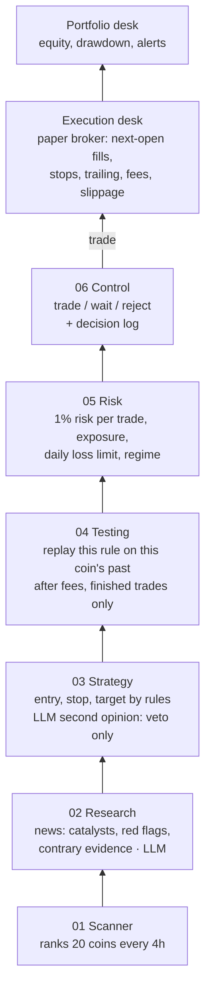
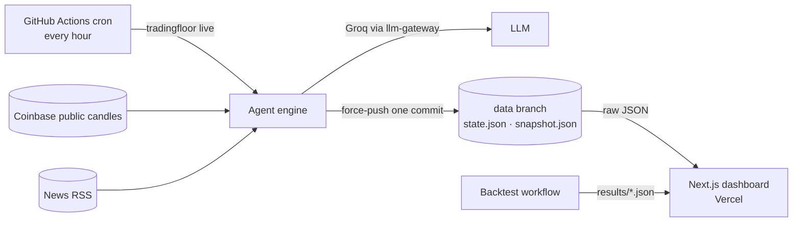

# Agent Trading Firm

[](https://github.com/Tanzil-Ali-Rizvi/agent-trading-firm/actions/workflows/ci.yml)
[](https://github.com/Tanzil-Ali-Rizvi/agent-trading-firm/actions/workflows/live.yml)
[](https://agent-trading-firm.vercel.app)


**An AI trading firm with six floors. Every idea has to climb all of them before it becomes a trade, and "wait" is a valid answer.** It paper-trades 20 liquid crypto coins around the clock on live Coinbase data, logs every decision with its reasons, and is measured against buy-and-hold with fees, slippage and ablations.

**[Open the live dashboard →](https://agent-trading-firm.vercel.app)**

> Paper trading with simulated money. Nothing here is investment advice, and nothing here places real orders.



## Why it is built this way

Most "AI trading bot" demos let a language model pick trades and then show a profit screenshot. This project is built to answer the question a risk manager would ask: *what does each part actually contribute, and would it survive real costs?*

| Principle | How it shows up |
|---|---|
| **Numbers come from code, not from the LLM** | Entry, stop, target and size are computed by rules. The LLM writes the research summary and the trade thesis, and can **only veto**. A test feeds it hostile output (`"units": 1e9, "stop": 0`) and checks that nothing changes. |
| **Test the rule before trusting it** | The testing floor replays the exact entry rule on the coin's own history, with fees and slippage, and only counts trades that had **finished before the decision time**. No edge, no trade. |
| **Waiting is a decision** | Every failed check is either *reject* (the idea is bad) or *wait* (the idea may be fine, the book can't take it now: risk-off market, too many positions, daily loss limit). |
| **One code path** | The backtest and the live loop both call `TradingFirm.step(now)`. There is no separate "backtest version" of the strategy. |
| **No look-ahead** | Agents only see bars that had closed (`MarketData.view(now)`), entries fill at the *next* bar's open, a bar that touches both stop and target counts as a stop, and gaps through a stop exit at the open. Tests cover each of these. |
| **Untrusted text stays data** | News headlines are cleaned, capped and passed to the model as JSON data; the model's answer can only block a trade, never start one. |
| **Ablations, not a best run** | The backtest re-runs with floors removed and with retail fees, and an anonymised LLM ablation measures whether the LLM's vetoes pick worse trades than the ones it approves. |

## Results

The backtest runs in GitHub Actions on three years of hourly Coinbase candles: the first year only feeds the testing floor's history, and trading is measured on the last two. Parameters were fixed before the run (see `config.py`); there is no parameter search.

Full tables: [`results/backtest.md`](results/backtest.md) and [`results/llm_ablation.md`](results/llm_ablation.md).

**Two years, 1 Nov 2024 to 1 Nov 2026, 20 coins, $10,000 paper account, 0.10% fee + 0.05% slippage per side:**

| System | Return | Max drawdown | Sharpe | Trades | Win rate | Avg trade |
|---|---|---|---|---|---|---|
| **Full firm** (rules, no LLM) | **−4.3%** | **−25.1%** | −0.04 | 175 | 29% | −0.02R |
| without the testing floor | +5.7% | −30.4% | 0.24 | 286 | 31% | +0.04R |
| without the risk floor | −12.8% | −45.1% | −0.14 | 203 | 28% | −0.07R |
| without testing and risk | +1.1% | −45.1% | 0.17 | 361 | 31% | +0.03R |
| full firm at retail fees (0.6%) | −27.3% | −34.9% | −1.09 | 113 | 26% | −0.31R |
| Bitcoin, buy and hold | +10.1% | −53.9% | 0.33 | | | |
| All 20 coins, equal weight, buy and hold | −19.2% | −76.7% | 0.22 | | | |

**What this says, plainly:**

- **The entry rule has no reliable edge.** Every variant's profit factor is about 1.0 and the average trade is within ±0.07R of zero. A trend-following breakout made +13.6% in the late-2024 rally and gave it back in the 2025–26 chop, which is what trend following does when trends don't last. I did not tune the parameters after seeing this: a version tuned on this period would look better here and mean nothing.
- **The risk floor does its job.** It halves the worst drawdown compared with the same rule without limits (−25% vs −45%), and the firm's drawdown is half of Bitcoin's and a third of the 20-coin basket's, with money in the market only 24% of the time.
- **The testing floor did not help.** It rejected 277 ideas and held back 160 because the rule's recent record on that coin was poor, yet the run without it did slightly better. Filtering a rule with no edge by its own recent record mostly filters noise. The floor stays, because its value is refusing to trade a rule that has *demonstrably* stopped working, but this run gives it no credit.
- **Costs decide everything for a marginal strategy.** At a retail exchange's 0.6% fee the same firm loses 27%.

The system itself works: it measures honestly, fails safely and caps losses. The strategy inside it doesn't make money. That is the useful result, and it is the reason the backtest, ablations and decision log exist.

<!-- ABLATION -->

## The floors

| Floor | Job | Decided by |
|---|---|---|
| 01 Scanner | Ranks all 20 coins every 4 hours on 7-day and 24-hour momentum, trend and volume; sends coins that are in an uptrend *and* breaking out up the building | rules |
| 02 Research | Reads CoinDesk, Cointelegraph and Decrypt headlines that mention the coin; returns sentiment, catalysts, red flags and **counterpoints** | LLM (can only block) |
| 03 Strategy | Entry rules on 4h bars: close > EMA50 > EMA200, close above the 20-bar high, MACD histogram > 0, volume ≥ 1.5× average, RSI 55 to 80. Stop 2 ATR, target 4R, breakeven at +2R, 3-ATR trailing stop. Then an LLM second opinion | rules + LLM veto |
| 04 Testing | Replays the rule on this coin's last 365 days (≥ 8 finished trades averaging ≥ +0.10R after costs), else on the whole universe (≥ 30 trades); otherwise *wait* | rules |
| 05 Risk | Liquidity, volatility and reward/risk (*reject*); BTC regime, open positions ≤ 5, total open risk ≤ 5%, daily loss limit 3%, cooldown after a stop-out (*wait*). Size = 1% of equity at risk, capped at 20% of equity | rules |
| 06 Control | Final call from the floors' verdicts, a kill switch, and the decision log | rules |
| Execution desk | Paper broker: next-hour open fills, 0.10% fee + 0.05% slippage per side, stop / breakeven / trailing stop / target, pessimistic intrabar rules | rules |
| Portfolio desk | Hourly mark-to-market, equity curve, drawdown and market alerts | rules |

LLM calls go through **[llm-gateway](https://github.com/Tanzil-Ali-Rizvi/llm-gateway)** (my project #5), embedded in-process: Groq `gpt-oss-120b` with fallback to `gpt-oss-20b`, retries, caching and per-call cost tracking. Point `LLM_BASE_URL` at any OpenAI-compatible endpoint to use something else. Without a key the firm runs rules-only.

## How it runs



No server to keep alive: the hourly workflow is the clock, the `data` branch is the database (force-pushed as a single commit so history doesn't grow), and the dashboard is a static site that reads the JSON. A run that starts late processes every missed hour for exits, but only the newest 4-hour boundary may open trades, so it never trades on stale news.

## Run it yourself

```bash
pip install -e ".[llm,api,dev]"

tradingfloor backtest --warmup-days 400            # synthetic prices, no network
tradingfloor download --start 2023-11-01 --out data/market.json.gz
tradingfloor backtest --data data/market.json.gz --start 2024-11-01 --out results
GROQ_API_KEY=... tradingfloor llm-ablation --data data/market.json.gz --start 2024-11-01
GROQ_API_KEY=... tradingfloor live --state-dir state  # one live paper-trading cycle
tradingfloor serve --state-dir state                # local API for the dashboard

cd dashboard && npm ci && NEXT_PUBLIC_SNAPSHOT_URL=http://localhost:8000/snapshot.json npm run dev
```

`pytest` runs 18 tests: indicator causality, the point-in-time view, the testing floor ignoring unfinished trades, fills, gaps, stop-before-target, breakeven and trailing stops, cash accounting, sizing, daily loss limit, LLM output validation and fail-closed behaviour, hostile headlines and LLM output, determinism, and live state resuming across runs.

## Project layout

```
src/tradingfloor/
  firm.py            the building: one idea up six floors, then execution and portfolio
  agents/            scanner, research, strategy, testing, risk, control, executor, portfolio
  market.py          Coinbase download, point-in-time MarketView, synthetic data for tests
  backtest.py        replay + ablations + buy-and-hold benchmarks
  ablation.py        anonymised LLM-veto study with bootstrap confidence interval
  live.py            hourly paper-trading run and dashboard snapshot
  llm.py             llm-gateway (in-process) / any OpenAI-compatible endpoint / scripted for tests
dashboard/           Next.js static site: the building, elevator log, market, book, testing results
.github/workflows/   ci.yml · backtest.yml · live.yml
```

## Limitations

- Paper trading only. Live fills would differ from next-open-plus-slippage, especially in fast markets.
- Long-only spot on 20 coins; no shorting, funding, or portfolio-level correlation limits beyond the BTC regime filter.
- The testing floor replays on 4-hour bars while the executor manages exits on 1-hour bars, so its estimates are approximate.
- Research uses headlines only (no article bodies, on-chain or social data), and only in live mode; historical headlines aren't available for the backtest.
- GitHub disables scheduled workflows after 60 days without repository activity.

## License

MIT
